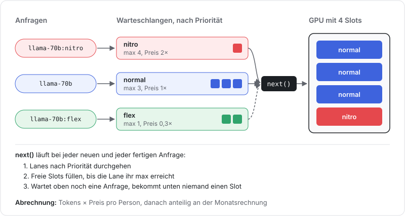

# friends-with-priorities

Ein Proxy vor einem selbst gehosteten LLM (vLLM, llama.cpp, ollama), den sich mehrere Freunde teilen. Er spricht die OpenAI-API, jeder OpenAI-Client funktioniert also. Er legt fest, welche Anfrage wann auf die GPU darf, und verteilt die Serverkosten nach Verbrauch.



## Lanes

Ein Tag am Modellnamen bestimmt die Lane:

| Modell            | Priorität  | max. parallel | Preis |
| ----------------- | ---------- | ------------- | ----- |
| `llama-70b:nitro` | höchste    | 4             | 2×    |
| `llama-70b`       | mittlere   | 3             | 1×    |
| `llama-70b:flex`  | niedrigste | 1             | 0,3×  |

## Ablauf

Die GPU hat 4 Slots, jede Lane hat eine eigene Warteschlange. Bei jeder neuen und jeder fertigen Anfrage läuft `next()`:

1. Die Lanes werden nach Priorität durchgegangen.
2. Jede Lane füllt freie Slots, bis sie ihr `max` erreicht.
3. Wartet in einer Lane noch eine Anfrage, bekommen die Lanes darunter keinen Slot.

Nitro kommt also zuerst dran. Normal belegt höchstens 3 Slots, damit bleibt einer für Nitro frei. Flex läuft nur, wenn sonst niemand wartet, und nie mehr als eine Anfrage gleichzeitig. Laufende Anfragen werden nicht unterbrochen.

Der Request geht unverändert ans Backend, also auch Tools, `response_format` und Streaming. Nur der Tag wird vom Modellnamen entfernt. Bei Streams bleibt der Slot belegt, bis das Backend fertig ist. Bricht der Client ab, wird die Anfrage aus der Warteschlange genommen oder das Backend gestoppt.

## Abrechnung

Jeder API-Key gehört zu einer Person. Pro Anfrage werden `Tokens × Preis der Lane` gebucht, monatsweise in `usage.json`. Bei abgebrochenen Streams wird ungefähr ein Token pro gesendetem Chunk berechnet.

Die Monatsrechnung wird anteilig aufgeteilt, die Beträge summieren sich exakt zur Rechnung:

```sh
node priorities.mjs bill 2026-10 30
# { bob: 15.15, carol: 12.12, alice: 2.73 }
```

## Starten

Keine Dependencies, getestet mit Node 24.

```sh
node priorities.mjs          # Demo mit simuliertem Backend
node priorities.mjs serve    # Server auf Port 8080
```

Client-Konfiguration:

```sh
export OPENAI_BASE_URL=http://localhost:8080/v1
export OPENAI_API_KEY=sk-alice
```

Für ein echtes Backend den auskommentierten `fetch` in `gpu()` einsetzen und `MODELS` und `FRIENDS` anpassen. Ohne diese Änderung antwortet auch der Server mit dem simulierten Backend.

## Einschränkungen

- Nur `/v1/models` und `/v1/chat/completions`.
- Keine Größenbegrenzung für Requests.
- Flex kann bei Dauerlast lange warten.
